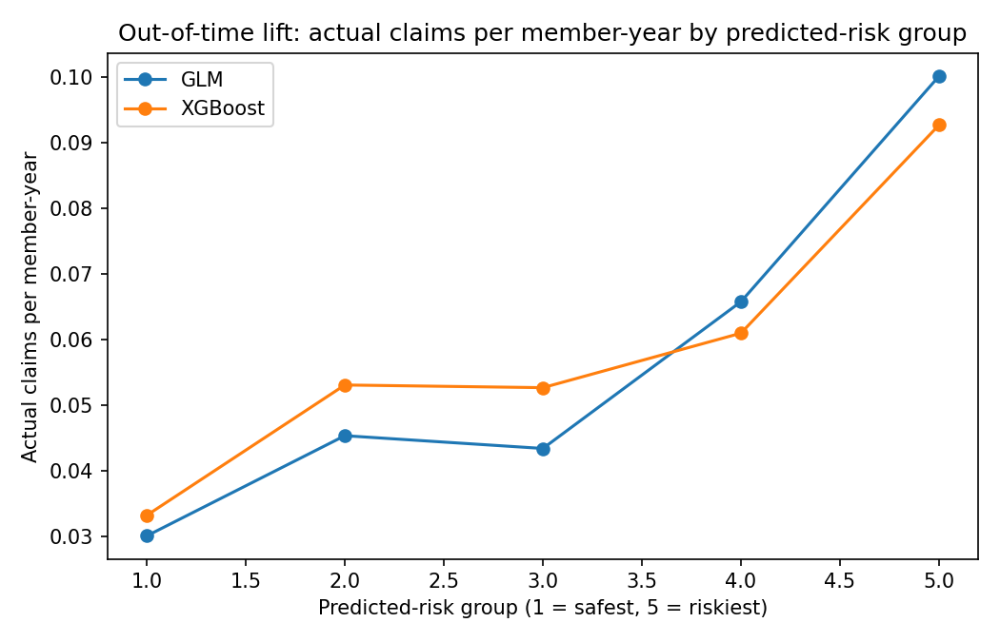

# Governed AI Agent: GLM vs XGBoost for Health Insurance Claim Frequency

An AI agent (Python, Agno, Gemini) that compares a **Poisson GLM** and an **XGBoost challenger** for health insurance claim frequency, checks whether the difference is real or luck, refuses forbidden inputs, and drafts a model-comparison memo for an actuary to review.

> **All data is synthetic** (fictional insurer "ABC Health"). Nothing here uses real policyholder data.

## What it does

- Trains both models on policies starting in months 1-6 and tests on months 10-12 (an out-of-time split, as insurers do).
- Compares them with four yardsticks: Poisson deviance, Gini, actual-over-expected, and the riskiest-vs-safest ratio. It also shows a lift chart and calibration by age band.
- Gives the AI agent seven tools: model comparison, lift table, age-band calibration, GLM relativities, SHAP drivers, a **feature guardrail**, and a **bootstrap significance test**.
- Produces a one-page model comparison memo ending in "Draft for review - not signed".

## Results (test quarter: 12,463 policies, 482 claims)

| Metric | GLM | XGBoost | Better |
|---|---|---|---|
| Poisson deviance (lower is better) | 0.3850 | 0.3947 | GLM |
| Gini (higher is better) | 0.2696 | 0.1784 | GLM |
| Actual / expected (1.00 is ideal) | 1.0102 | 1.0142 | tie |
| Riskiest 20% vs safest 20% | 3.32x | 2.79x | GLM |

A bootstrap test (re-sampling the test policies) gave 95% intervals that excluded zero for both the Gini and deviance differences, so the GLM's advantage on this data is unlikely to be test-sample luck.

## Governance: what the agent will not do

- **Refuses leaky or forbidden inputs.** Asked to add `claim_amount_inr` to XGBoost, the agent calls the guardrail tool, refuses because the column is only known after a claim happens, and lists the approved features instead.
- **Won't pick a winner on one number.** Its rules require a bootstrap check first, and it must say when a result is inconclusive.
- **Never states a metric that didn't come from a tool call.**
- **Stays in scope:** claim frequency on this dataset only (no severity, premiums or reserving). Asked for 2027 frequency, it says this is out of scope.
- **Human sign-off:** every memo is a draft for an actuary to review.

## Limitations (please read)

- The synthetic data was generated from a GLM-style formula, which favours the GLM. On real data, XGBoost could do better.
- Only 482 claims in the test quarter. Age-band results (about 70-140 claims each) are noisy, and the age-band miscalibration seen here is mostly sampling luck.
- One train/test split. The bootstrap re-samples test policies only; it does not retrain the models or test other periods.
- Frequency only. No severity model, so no premiums.
- LLMs can still misquote numbers, so check the memo against the tool outputs before relying on it.

## How to run

1. Open `glm_vs_xgb_agent.ipynb` in Google Colab.
2. Get a free Gemini API key at https://aistudio.google.com/apikey and add it in Colab's Secrets panel (key icon) as `GOOGLE_API_KEY`, with notebook access on. Never paste the key into the notebook.
3. Run all cells. If the model name `gemini-3.5-flash-lite` errors, switch to a current Gemini model name in section 8.

## Credits

Completed individually as a case study from the 9th IAI Capacity Building Seminar in Health and Care Insurance, under the guidance of **Sathya Sai Mudigonda and Dr. Rohan Yashraj Gupta, FIA FIAI**.
Built on the seminar's workshop notebooks (https://github.com/rohanyashraj/iai-workshop): the synthetic data generator, GLM and XGBoost setup and agent pattern come from there.
My extensions: the feature guardrail, Poisson deviance / Gini / actual-vs-expected metrics, calibration by age band, the bootstrap significance test, the seven-tool governed agent, and the memo output.
